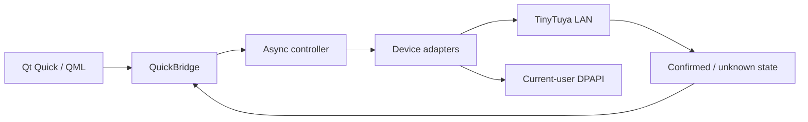

# Smart Tray

**Local smart-device controls, one compact Windows panel.**

Smart Tray is an open-source Windows application for controlling compatible Tuya
smart devices locally, featuring a modern Qt Quick interface, animated controls,
and system tray integration.


> Compatibility is device-specific. This is not a universal Tuya controller. The
> public repository contains no configured home devices or credentials.

## See the interface

These are **actual screenshots rendered by the application's QML**, with synthetic
device states and isolated preferences. They are not generated artwork or evidence
of live device state. No hardware commands were used to capture them.

| Climate | Lighting | Smart switch |
|:---:|:---:|:---:|
|  |  |  |

Reproduce the gallery: `python scripts/capture_docs.py`. Personal reference photos
are not distributed; the application uses code-native QML illustrations.

**Navigate:** [Features](#features) · [Devices](#supported-devices) ·
[Getting started](#getting-started) · [Setup](docs/device-setup.md) ·
[Architecture](#architecture) · [Build](#building-for-windows) ·
[Troubleshooting](#troubleshooting) · [Contributing](#contributing)

## Features

- **Local Tuya communication:** adapters talk directly to configured devices over
  LAN. Normal controls do not use Cloud credentials.
- **Modern QML:** dark theme, animated illustrations and responsive controls.
- **Climate:** setpoint buttons/slider, ambient temperature and own-profile Elgin
  controls, with validated and experimental capabilities kept distinct.
- **Lighting:** power, HSV fixed color, eight preset colors, brightness and saved
  favorites. The wall preview follows confirmed fixed-color state.
- **Dual-channel switch:** independent touch-output and socket controls.
- **Windows tray:** reopen, refresh or explicitly exit. Close/minimize hide to tray;
  clicking outside does not hide the existing window.
- **Persistent position:** draggable header and monitor-aware bounds.
- **User startup:** HKCU registration without administrator privileges.
- **DPAPI protection:** current-user encrypted keys outside the repository.
- **Async workers:** bounded communication and explicit offline/unknown state;
  uncertain writes are never automatically repeated.

There is **no Scenes tab or usable RGBIC effect catalog** in 2.3.1. Effects selected
on the device produce only an informational preview-unavailable message.

## Supported devices

| Hardware used during development | LAN | Integration |
|---|---|---|
| Elgin Eco Inverter III HJFC12C2WGCG | 3.5 | Setpoint and fan; additional schema-bound controls behind opt-in |
| Outsmart RGBIC LED | 3.3 | Power, fixed color, brightness and favorites; no RGBIC effects |
| NovaDigital smart switch | 3.4 | DP1 touch output and DP2 socket on the tested plate |

Read [compatibility](docs/compatibility.md) for DP mappings, validation distinctions
and limitations. Other devices, even of the same brand, can require new adapters.

## Getting started

### Prerequisites

Windows 11 x64, Python **3.14** and Git. Dependencies are pinned in
`requirements.txt`; the reference environment is recorded in `requirements.lock.txt`.
Node.js is optional for one offline JavaScript helper test. Hardware is not required.

### 1. Clone and install

```powershell
git clone https://github.com/joaopedrobn/smart-tray.git
cd smart-tray
python -m venv .venv
.\.venv\Scripts\Activate.ps1
python -m pip install -r requirements.txt
```

If PowerShell blocks activation, use the interpreter directly rather than changing
the machine-wide execution policy:

```powershell
.\.venv\Scripts\python.exe -m pip install -r requirements.txt
```

Analysis-only dependencies in `requirements-analysis.txt` are not needed to run
the app. Build dependencies are installed separately below.

### 2. Start without devices

```powershell
.\.venv\Scripts\pythonw.exe scripts/run_app.py --config-root .\private-config
```

The root may be empty. Devices remain unavailable and controls disabled; the app
does not simulate online state or open a provisioning dialog automatically.
Use `pythonw.exe` to avoid a console. UI labels currently use Portuguese.

Preferences and DPAPI ciphertext stay under `%LOCALAPPDATA%\SmartTray`. Close or
minimize hides to the tray; use **Sair do Smart Tray** to end the process. Launching
again activates the same window. No administrator privileges are required.

### 3. Set up your devices

Follow [Device setup](docs/device-setup.md): Tuya/Smart Life terminology, verified
identity/IP, discovery, private files, authorized key acquisition and safe provisioning.

```powershell
Copy-Item -Recurse examples\config private-config
# Edit private files with your own identifiers and verified addresses.
.\.venv\Scripts\pythonw.exe scripts/provision.py --manual --config-root .\private-config --role led
.\.venv\Scripts\python.exe scripts/read_local.py --config-root .\private-config --role led
```

Examples deliberately **do not authorize controls**. Authentication, own-device
schema and physical validation are separate. No generic profile wizard is
implemented. Do not copy synthetic test validation flags into a real profile.

### 4. Test and check imports

```powershell
.\.venv\Scripts\python.exe -m pytest -q
.\.venv\Scripts\python.exe -m compileall -q src scripts
```

Tests use synthetic fixtures and mocked transports, without Tuya accounts, keys or
devices. A Windows Actions workflow is included; it does not upload builds or
publish releases. No coverage percentage or remote CI success is claimed.

## Architecture

Local publication-preparation validation passed **472 tests**, including an isolated
copy without personal configuration. This is not a claim about remote CI execution.



Adapters validate identity, schema and values; workers avoid blocking QML. The
normal command path reads fresh state, writes one intent and reads again. LED
fixed-color selection may first select its documented mode, then send color,
sequentially. Animations and navigation never issue control commands.

See [architecture](docs/architecture.md). Historical `beta*` module names remain;
the application version is stable 2.3.1.

## Building for Windows

```powershell
.\.venv\Scripts\python.exe -m pip install -r requirements-build.txt
.\.venv\Scripts\python.exe scripts/build_quick.py
```

Default output is `dist/public/SmartTray/SmartTray.exe`, with `_internal` and
`build-info.json`. PyInstaller builds **onedir**, Windows x64 GUI mode: no console
and no target-machine Python dependency. Keep the entire folder together.

The default public build contains empty device configuration and does not overwrite
an existing personal `dist/SmartTray`. Use `--config-root` to select private profiles.
`--data-root` is an optional private build input and **must not be used for a public
release**. Existing configured portable ZIPs are not safe release assets.

Read [redistribution](docs/redistribution.md) before distributing binaries.
MIT covers this project's code, not all bundled dependency licenses.

## Troubleshooting

| Problem | What to check |
|---|---|
| Offline/unavailable | Exact ID, address, local network and protocol; empty configuration is intentionally disabled. |
| Invalid Local_Key | Import a current authorized key locally; pairing changes can invalidate it. Never paste it into an issue. |
| Wrong Device ID | Match app, registry and profile. An IP address alone is not identity evidence. |
| Protocol mismatch | Check discovery and authenticated read; 3.3/3.4/3.5 support is not universal compatibility. |
| TCP 6668 inaccessible | Device reachability, guest-network isolation and local firewall. Do not forward the port to the internet. |
| QML error | Keep the complete onedir folder, use matching pinned Qt packages and run `python -m pip check`. |
| DPAPI unavailable | Ciphertext from another Windows user/machine is not portable; provision for the current identity. |
| Executable fails to start | Extract the entire folder; inspect security-software notices. Builds are unsigned. Do not broadly disable protections. |
| Tray icon missing | Check Windows hidden icons. Launch again to activate an already-running instance. |
| Disabled controls | Own authenticated profile, schema and command evidence; additional controls require settings opt-in. |
| Startup uses old location | Disable/re-enable after moving the executable. An explicit private root is preserved. |
| Effect preview unavailable | Expected: use the official app for scenes, which are not editable here. |

Do not upload private configuration, raw Cloud responses, whole diagnostic folders
or ciphertext. See [SECURITY.md](SECURITY.md).

## Contributing

Adapters, tests, accessibility, bug fixes and documentation are welcome. Read
[CONTRIBUTING.md](CONTRIBUTING.md), open an
[issue](https://github.com/joaopedrobn/smart-tray/issues) or submit a focused pull
request against `main`. Keep hardware writes out of tests and unknown DPs out of controls.

## Possible future work

Ideas, not implemented features or dated commitments:

- More adapters and verified DP mappings.
- Easier safe onboarding.
- RGBIC support backed by real product evidence.
- Community themes and accessibility improvements.

## License and acknowledgements

Project-authored code and illustrations are [MIT](LICENSE). Third-party components
retain their licenses; see [notices](THIRD_PARTY_NOTICES.md),
[dependency inventory](licenses/dependency-inventory.json) and
[redistribution](docs/redistribution.md). Qt/PySide6 have separate LGPL/GPL or
commercial terms. The project is not endorsed by Tuya, Elgin, Outsmart or NovaDigital.
