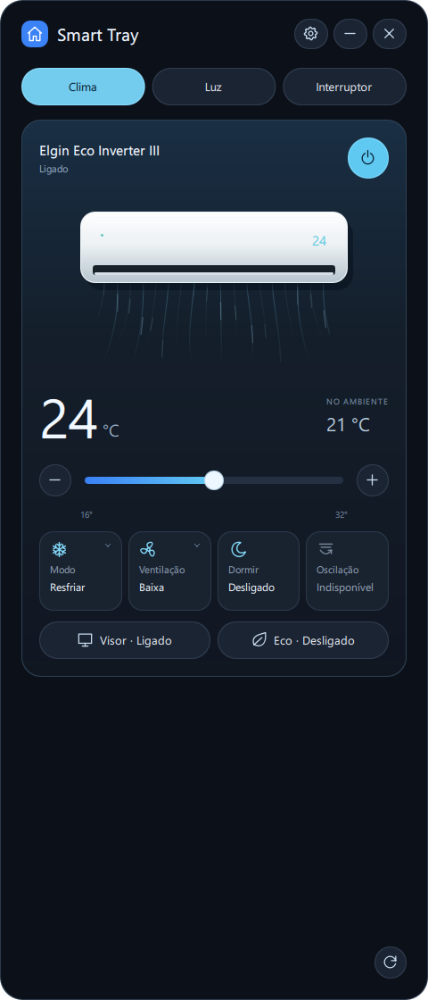
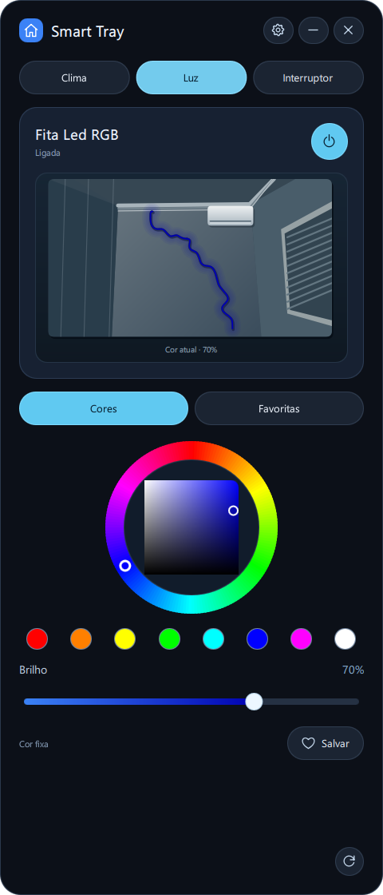
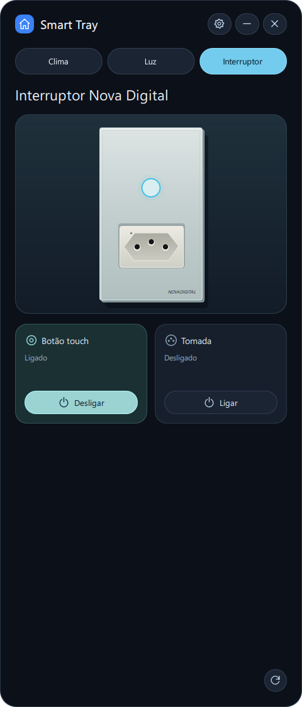
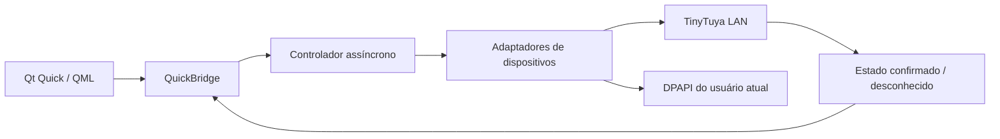

<p align="center">
  <a href="README.md">🇺🇸 English</a>
  &nbsp; | &nbsp;
  <a href="README.pt-BR.md">🇧🇷 Português (Brasil)</a>
</p>

# Smart Tray

**Controle local dos seus dispositivos inteligentes em um painel compacto para Windows.**

O Smart Tray é um aplicativo de código aberto para Windows que controla dispositivos
Tuya compatíveis pela rede local, com uma interface moderna em Qt Quick, controles
animados e integração com a bandeja do sistema.


> A compatibilidade depende de cada dispositivo. Este aplicativo não é um controlador
> universal para Tuya. O repositório público não contém dispositivos domésticos
> configurados nem credenciais.

## Conheça a interface

Estas são **capturas reais da interface QML do aplicativo**, com estados simulados
dos dispositivos e preferências isoladas. Não são imagens geradas artificialmente
nem representam o estado de aparelhos reais. Nenhum comando foi enviado aos
dispositivos para produzir as capturas.

| Clima | Iluminação | Interruptor inteligente |
|:---:|:---:|:---:|
|  |  |  |

Para reproduzir a galeria: `python scripts/capture_docs.py`. As fotos pessoais usadas
como referência não são distribuídas; as ilustrações são desenhadas em código QML.

**Navegue:** [Funcionalidades](#funcionalidades) · [Dispositivos](#dispositivos-suportados) ·
[Primeiros passos](#primeiros-passos) · [Configuração — em inglês](docs/device-setup.md) ·
[Arquitetura](#arquitetura) · [Build](#gerando-o-executável-para-windows) ·
[Resolução de problemas](#resolução-de-problemas) · [Contribuições](#como-contribuir)

## Funcionalidades

- **Comunicação local com Tuya:** os adaptadores se comunicam diretamente com os
  dispositivos configurados pela LAN. Os controles normais não usam credenciais Cloud.
- **Interface moderna em QML:** tema escuro, ilustrações animadas e controles responsivos.
- **Clima:** botões e slider de temperatura, leitura da temperatura ambiente e controles
  Elgin definidos pelo perfil do próprio aparelho, distinguindo funções validadas e
  experimentais.
- **Iluminação:** liga/desliga, cor fixa em HSV, oito cores predefinidas, brilho e cores
  favoritas salvas. A prévia da parede acompanha o estado confirmado da cor fixa.
- **Interruptor com dois canais:** controles independentes para a saída touch e a tomada.
- **Bandeja do Windows:** reabrir, atualizar ou sair explicitamente. Fechar ou minimizar
  oculta o painel na bandeja; clicar fora não esconde a janela.
- **Posição persistente:** cabeçalho arrastável e posicionamento que respeita os monitores.
- **Inicialização por usuário:** registro em HKCU, sem privilégios de administrador.
- **Proteção DPAPI:** chaves criptografadas para o usuário atual, fora do repositório.
- **Workers assíncronos:** comunicação com limites definidos e indicação de estado
  offline ou desconhecido; escritas com resultado incerto nunca são repetidas automaticamente.

A versão 2.3.1 **não possui aba Cenas nem catálogo utilizável de efeitos RGBIC**.
Efeitos selecionados no aparelho geram apenas um aviso informativo de prévia indisponível.

## Dispositivos suportados

| Aparelho utilizado durante o desenvolvimento | LAN | Integração |
|---|---|---|
| Elgin Eco Inverter III HJFC12C2WGCG | 3.5 | Temperatura configurada e ventilação; controles adicionais dependentes do schema, mediante ativação explícita |
| Outsmart RGBIC LED | 3.3 | Liga/desliga, cor fixa, brilho e favoritas; sem efeitos RGBIC |
| Interruptor inteligente NovaDigital | 3.4 | DP1 para a saída touch e DP2 para a tomada na placa testada |

Consulte o [guia de compatibilidade — em inglês](docs/compatibility.md) para conhecer
os mapeamentos DPS, as diferenças de validação e as limitações. Outros aparelhos,
mesmo da mesma marca, podem exigir novos adaptadores.

## Primeiros passos

### Requisitos

Windows 11 x64, Python **3.14** e Git. As versões das dependências estão fixadas em
`requirements.txt`; o ambiente de referência está registrado em `requirements.lock.txt`.
Node.js é opcional para um teste offline de um helper JavaScript. Não é necessário
ter dispositivos reais para executar os testes.

### 1. Clone e instale

```powershell
git clone https://github.com/joaopedrobn/smart-tray.git
cd smart-tray
python -m venv .venv
.\.venv\Scripts\Activate.ps1
python -m pip install -r requirements.txt
```

Se o PowerShell bloquear a ativação, use o interpretador diretamente, sem alterar
a política de execução de todo o computador:

```powershell
.\.venv\Scripts\python.exe -m pip install -r requirements.txt
```

As dependências de análise em `requirements-analysis.txt` não são necessárias para
executar o aplicativo. As dependências de build são instaladas separadamente, conforme
as instruções abaixo.

### 2. Inicie sem dispositivos

```powershell
.\.venv\Scripts\pythonw.exe scripts/run_app.py --config-root .\private-config
```

O diretório de configuração pode estar vazio. Os dispositivos ficam indisponíveis
e os controles desabilitados; o aplicativo não simula um estado online nem abre
automaticamente uma janela de provisionamento. Use `pythonw.exe` para não abrir um
console. Os textos da interface estão atualmente em português.

As preferências e as credenciais criptografadas por DPAPI ficam em
`%LOCALAPPDATA%\SmartTray`. Fechar ou minimizar oculta o painel na bandeja; use
**Sair do Smart Tray** para encerrar o processo. Abrir o aplicativo novamente ativa
a mesma janela. Não são necessários privilégios de administrador.

### 3. Configure seus dispositivos

Siga o [guia de configuração — em inglês](docs/device-setup.md): termos Tuya/Smart Life,
verificação de identidade e IP, descoberta, arquivos privados, obtenção autorizada
de chaves e provisionamento seguro.

```powershell
Copy-Item -Recurse examples\config private-config
# Edite os arquivos privados com seus próprios identificadores e endereços verificados.
.\.venv\Scripts\pythonw.exe scripts/provision.py --manual --config-root .\private-config --role led
.\.venv\Scripts\python.exe scripts/read_local.py --config-root .\private-config --role led
```

Os exemplos **não autorizam controles**, intencionalmente. Autenticação, schema do
próprio dispositivo e validação física são etapas distintas. Não existe um assistente
genérico de perfis implementado. Não copie os indicadores de validação dos testes
simulados para um perfil real.

### 4. Execute os testes e verifique os imports

```powershell
.\.venv\Scripts\python.exe -m pytest -q
.\.venv\Scripts\python.exe -m compileall -q src scripts
```

Os testes usam fixtures sintéticas e transportes simulados, sem contas Tuya, chaves
ou aparelhos reais. O projeto inclui um workflow do GitHub Actions para Windows;
ele não envia builds nem publica releases. Não são declarados percentuais de cobertura
ou sucesso da CI remota.

## Arquitetura

A validação local de preparação para publicação passou em **472 testes**, incluindo
uma cópia isolada sem configuração pessoal. Esse resultado não representa a execução
da CI remota.



Os adaptadores validam identidade, schema e valores; os workers evitam bloquear a
interface QML. O fluxo normal de comandos consulta o estado atual, envia a alteração
solicitada e consulta novamente. Ao selecionar uma cor fixa da fita, o aplicativo
pode primeiro ativar o modo documentado e depois enviar a cor, em sequência.
Animações e navegação nunca enviam comandos de controle.

Consulte a [documentação de arquitetura — em inglês](docs/architecture.md).
Os nomes históricos de módulos `beta*` foram mantidos; a versão do aplicativo é a
2.3.1 estável.

## Gerando o executável para Windows

```powershell
.\.venv\Scripts\python.exe -m pip install -r requirements-build.txt
.\.venv\Scripts\python.exe scripts/build_quick.py
```

A saída padrão é `dist/public/SmartTray/SmartTray.exe`, junto de `_internal` e
`build-info.json`. O PyInstaller gera uma build **onedir**, com interface gráfica
para Windows x64: sem console e sem exigir Python instalado no computador de destino.
Mantenha a pasta completa junto do executável.

A build pública padrão contém configuração vazia e não substitui uma instalação
pessoal existente em `dist/SmartTray`. Use `--config-root` para selecionar perfis
privados. `--data-root` é uma entrada opcional para builds privadas e **não deve ser
usada em uma release pública**. ZIPs portáteis já configurados não são artefatos
seguros para publicação.

Leia o [guia de redistribuição — em inglês](docs/redistribution.md) antes de distribuir
binários. A licença MIT cobre o código deste projeto, não todas as licenças das
dependências incluídas na build.

## Resolução de problemas

| Problema | O que verificar |
|---|---|
| Offline ou indisponível | ID exato, endereço, rede local e protocolo; uma configuração vazia mantém os controles desabilitados intencionalmente. |
| Local_Key inválida | Importe localmente uma chave atual obtida por método autorizado; mudanças de pareamento podem invalidá-la. Nunca publique a chave em uma Issue. |
| Device ID incorreto | Confira a correspondência entre aplicativo oficial, cadastro e perfil. Um endereço IP sozinho não comprova a identidade. |
| Protocolo diferente | Confira a descoberta e a leitura autenticada; o suporte a 3.3/3.4/3.5 não significa compatibilidade universal. |
| TCP 6668 inacessível | Verifique acesso ao dispositivo, isolamento da rede de convidados e firewall local. Não exponha a porta à internet. |
| Erro QML | Mantenha a pasta onedir completa, use as versões Qt fixadas e execute `python -m pip check`. |
| DPAPI indisponível | Credenciais criptografadas de outro usuário ou computador Windows não são portáteis; faça o provisionamento para o usuário atual. |
| Executável não inicia | Extraia a pasta inteira e confira os avisos do software de segurança. As builds não são assinadas. Não desative as proteções de forma ampla. |
| Ícone da bandeja não aparece | Confira os ícones ocultos do Windows. Abra novamente para ativar uma instância que já está em execução. |
| Controles desabilitados | Verifique o perfil autenticado do próprio dispositivo, o schema e as evidências dos comandos; controles adicionais exigem ativação nas configurações. |
| Inicialização usa um caminho antigo | Desative e reative a opção após mover o executável. Um diretório privado informado explicitamente é preservado. |
| Prévia de efeito indisponível | Comportamento esperado: use o aplicativo oficial para cenas, que não podem ser editadas aqui. |

Não envie configurações privadas, respostas Cloud brutas, pastas completas de
diagnóstico ou credenciais criptografadas. Consulte a [política de segurança — em inglês](SECURITY.md).

## Como contribuir

Contribuições em adaptadores, testes, acessibilidade, correções e documentação são
bem-vindas. Leia o [guia de contribuição — em inglês](CONTRIBUTING.md), abra uma
[Issue](https://github.com/joaopedrobn/smart-tray/issues) ou envie um Pull Request
com escopo bem definido para `main`. Mantenha comandos reais fora dos testes e
não implemente controles para DPS desconhecidos.

## Possíveis melhorias futuras

São ideias, não funcionalidades implementadas nem compromissos com prazo:

- Mais adaptadores e mapeamentos DPS verificados.
- Configuração inicial segura e mais simples.
- Suporte RGBIC baseado em evidências do produto real.
- Temas da comunidade e melhorias de acessibilidade.

## Licença e agradecimentos

O código e as ilustrações criados pelo projeto estão sob a [licença MIT](LICENSE).
Componentes de terceiros mantêm suas próprias licenças; consulte os
[avisos — em inglês](THIRD_PARTY_NOTICES.md), o
[inventário de dependências — em inglês](licenses/dependency-inventory.json) e o
[guia de redistribuição — em inglês](docs/redistribution.md). Qt/PySide6 têm termos
LGPL/GPL ou comerciais separados. O projeto não é endossado por Tuya, Elgin,
Outsmart ou NovaDigital.
