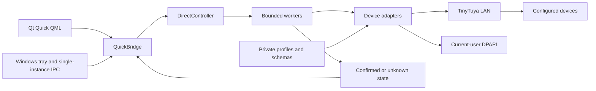

# Architecture

`app.py` creates the QApplication, per-user instance lock, tray menu and existing
QuickPanel. QML describes appearance; it does not construct network payloads.
`QuickBridge` exposes properties, drafts and explicit action slots.

`DirectController` keeps polling and command work out of the UI thread. State is
tracked separately for each device. Debounced sliders send an intent after the
interaction settles; animations and ordinary navigation do not issue writes.

Adapters check profile identity, schema and allowed values. A normal write reads
fresh state, applies one bounded command and reads again. The LED fixed-color
path can first select its documented mode and then color, sequentially. Failed or
uncertain writes are not automatically repeated.

## Configuration and persistence

Private configuration has `diagnostics/provisioned.json`, optional discovery and
schema files, and `profiles/<role>_profile.json`. Names are historical; these files
are not checked in. `--config-root` explicitly selects their containing directory.
An empty directory produces unavailable devices and disabled controls, not fake
state. Source mode also supports existing local project files for compatibility.

Preferences, favorites, window placement and DPAPI ciphertext live under the
current user's `%LOCALAPPDATA%\SmartTray`. The onedir public build contains empty
device configuration and a separately identified synthetic dataset used only by
explicit mock smoke tests. No background startup path selects simulation.

The system tray restores one existing window. Focus loss does not hide it.
Minimize and close hide to the tray; Exit stops workers and ends the process.
HKCU startup registration needs no administrator privileges.

## Historical research modules

Diagnostics/provisioning helpers remain available in source. Personal captures
are excluded. Modules named `beta*` are still part of the stable control policy;
their filenames do not imply a beta release. Scene research is isolated from the
current QML pages. It is not enabled by the presence of an offline encoder.
